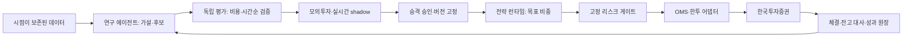

**한국투자증권 기반 Self-improving Trading Agent — 조사 및 설계**

**통합 연구 런타임 v1 / 앱 v0.5.2:** 저장소 루트의 `momentum-agent`가 미국 원장과 한투 선정을 연결해 네 단계 자동 연구·전진 관찰을 실행한다. 앱의 기존 연구기도 통합 런타임의 시장 단위 소비 구간을 존중한다. [실행·운영 문서](../../docs/automatic-research-agent.md)를 따른다.

**저장소 통합 v0.5.1:** 현재 위치는 `momentum-study/apps/kis-agent`다. 이후 개발은 이 저장소에서 진행한다. 기존 미국 주식 검증 엔진을 보존하면서 전일 종가 기준 최초 수량 산정·평가 전 동결 manifest를 보완했다. 앱 테스트는 **122개**, 상세 통합 범위는 [저장소 문서](../../docs/kis-agent-integration.md)에 기록했다. 아래 v0.2~v0.5 항목의 테스트 수는 각 버전 당시 기록이다.

작성·자료 확인일: 2026-10-16. 설계에 이어 **실행 가능한 로컬 MVP**를 구현했다. 시점 데이터·비용 포함 백테스트·한정된 파라미터 연구·영속 로컬 모의 주문·체결 대사까지 연결했다. 한투 인증 호출과 실제/한투 모의 주문은 수행하지 않았다.

**v0.5 업데이트 — 로직·자동 개선 우선:** 종목 상태·유동성·호가·변동성·100만 원 예산에 따른 후보 선정, 세 가지 순위 규칙, 선정/탈락 사유, 제한된 후보 생성과 독립 평가, 연구용 champion의 자동 갱신·유지·다음 전진 사이클까지 연결했다. **119개 테스트 통과.** 자동 주문 경로를 호출하지 않는다. [완료 범위·사용법](docs/08-selection-and-improvement.md).

**v0.4 업데이트:** 사용자 선택에 따라 **실전 키 연결 경로**와 **100만 원 운용 상한**을 추가했다. `KIS_APP_KEY`, `KIS_APP_SECRET`, `KIS_ACCOUNT`를 등록하고 `doctor --probe-real --symbol`로 인증·시세·잔고·당일 주문 조회를 점검한다. 실전 주문 엔진은 아직 없으며 현재 연결은 조회 전용이다. **88개 테스트 통과.** [실전 키 설정](docs/07-real-key-connection.md).

**v0.3 업데이트:** 비밀 값을 출력하지 않는 연결 진단, 평가 원본·데이터·코드·비용·위험을 고정한 후보 등록, 검토 기록이 있는 주문 없는 shadow 관찰, 재시작 후에도 유지되는 중단 상태를 추가했다. **78개 테스트 통과.** [관찰 운용·진단 절차](docs/06-shadow-operations.md)에 범위를 정리했다. 실제 서비스 호출은 여전히 미검증이다.

**v0.2 업데이트:** OpenAI Responses 구조화 후보 생성, 후보 파일 재사용·요청 예산 기록, 공통 브로커 계약, KIS 모의 전용 REST 어댑터와 CLI를 추가했다. 실제 OpenAI/KIS 서버 호출은 아직 검증하지 않았다. [2차 구현·연결 절차](docs/05-integrations.md)에 검증 범위와 제한을 정리했다.

권장 방향은 **한투 공식 API 어댑터 + 분리된 전략 연구 루프 + 독립 평가기 + 고정된 리스크·주문 엔진**이다. 자기 개선은 새 후보를 자동으로 만들고 검증 결과를 축적하는 능력으로 정의한다. 실거래 성과가 계속 좋아진다는 가정은 두지 않는다. 조건을 만족하는 후보가 없으면 기존 버전을 유지한다.

현재 사용자 선택은 실전 계좌 키·가용 자본 100만 원이다. 거래 대상·주기의 답변 전 가정은 국내 주식·ETF, 일봉/스윙, 현금 매수다. 첫 검증 대상은 사전 지정한 비레버리지 ETF의 소규모 유니버스로 권장한다. 실제 매매 종목·주문 계획·구체적 손실 한도는 아직 정하지 않았다. 코드·모델 자기 수정과 실거래 자동 승격은 구현하지 않았다.

문서:

- [조사 근거와 스킬·레퍼런스 평가](docs/01-research.md): 공식 한투 MCP/전략 빌더/백테스터, RD-Agent, Qlib, 커뮤니티 스킬의 채택 범위.
- [시스템 설계](docs/02-design.md): 데이터·전략·평가·집행 경계, 자기 개선 루프, 주문 상태·장애 처리, 배포 게이트.
- [구현 순서와 완료 조건](docs/03-roadmap.md): 모의투자까지의 작업과 실거래 승격 조건.
- [확인한 소스 목록](docs/source-manifest.json): 원문 URL, 저장소 버전, 확인 범위.
- [구현 현황과 사용법](docs/04-implementation.md): 실행 명령, 데이터 형식, 검증 범위, 남은 작업.
- [v0.2 LLM·한투 모의 연동](docs/05-integrations.md): 구조화 후보·누적 체결 원장·모의 전용 명령·실서버 검증 항목.
- [v0.3 진단·후보 등록·shadow 관찰](docs/06-shadow-operations.md): 평가 연결·변경 충돌 방지·손실 및 데이터 점검·영속 중단.
- [v0.4 실전 키 연결](docs/07-real-key-connection.md): 실전 인증·계좌 조회, 비밀 설정, 100만 원 상한과 현재 구현 범위.
- [v0.5 종목 선정·자동 개선](docs/08-selection-and-improvement.md): 시점 기반 필터·판단 근거·순위 비교·독립 평가·연구 champion 갱신·장애 복구.

현재 우선 개발 경로는 주문 없는 로직·자동 개선이다. 다음 명령 하나로 합성 데이터의 선정·유지·갱신·후속 사이클을 확인한다.

```bash
uv run python -m examples.offline_logic --output artifacts/logic-v5
```

산출물은 selection.json, research.json, study.json, verification.json과 영속 연구 DB다. 실제 시장 데이터 검증과 투자 성과를 대신하지 않는다.

프로젝트 루트에서 Python 3.11 이상으로 바로 실행할 수 있다. 런타임 외부 의존성은 없다.

```bash
PYTHONPATH=src python -m trading_agent demo --config configs/paper.toml --output artifacts/demo
PYTHONPATH=src python -m unittest discover -s tests -v
```

패키지 설치를 사용하는 경우:

```bash
uv sync
uv run kis-agent demo --config configs/paper.toml --output artifacts/demo
uv run kis-agent status --db artifacts/demo/agent.sqlite3 --account demo
```

데모는 합성 데이터로 report.md, backtest.json, research.json, paper.json, synthetic.csv와 SQLite 원장을 만든다. 동일 실행은 저장된 보고서·리플레이 완료 기록을 사용하며 중복 주문하지 않는다. 데이터·전략·비용·구현이 바뀌면 새 리플레이 계좌를 사용한다. 연구 DB는 평가 구간 소비 이력을 유지해야 하므로 평가를 다시 하기 위해 교체하지 않는다.

기본 후보 생성기는 lookback만 바꾸는 BoundedLookbacks이며, 구조화 LLM 제안이나 제안 파일로 대체할 수 있다. 코드 자기 수정·실거래 배포는 구현하지 않았다. 기본 위험·비용 수치는 로컬 데모용 예시다. 익일 시가 체결 모델은 후보 선별용이며, 실제 시장 성과를 검증한 결과가 아니다.

키 없이 두 연동 경로를 함께 검증하는 개발용 예제:

```bash
uv run python -m examples.offline_integration --output artifacts/integration-v2
uv run python -m examples.offline_operations --output artifacts/operations-v5
uv run kis-agent doctor
```

이 예제들은 합성 데이터·수기 API fixture·기록 형식의 LLM 응답만 사용한다. operations 예제의 반복 시장은 등록 성공 분기를 시험하도록 만들었다. 실제 서비스 호출은 0회이며 시장 성과의 근거가 아니다.



로컬 모의 주문 경로는 구현돼 있다. 현재 우선순위는 **시점 데이터 → 종목 선정 → 전략 판단 → 제한된 자동 개선 → 독립 평가 → 연구용 기준 전략 갱신**이며, 실제 데이터로 전진 검증한 근거를 축적한 뒤 자동 주문 연결을 다룬다.
