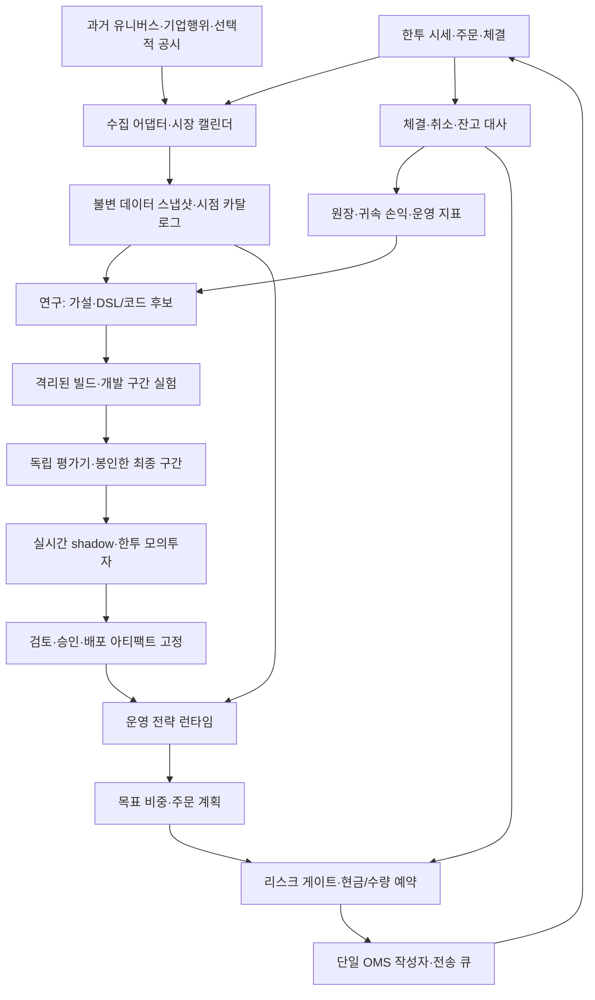
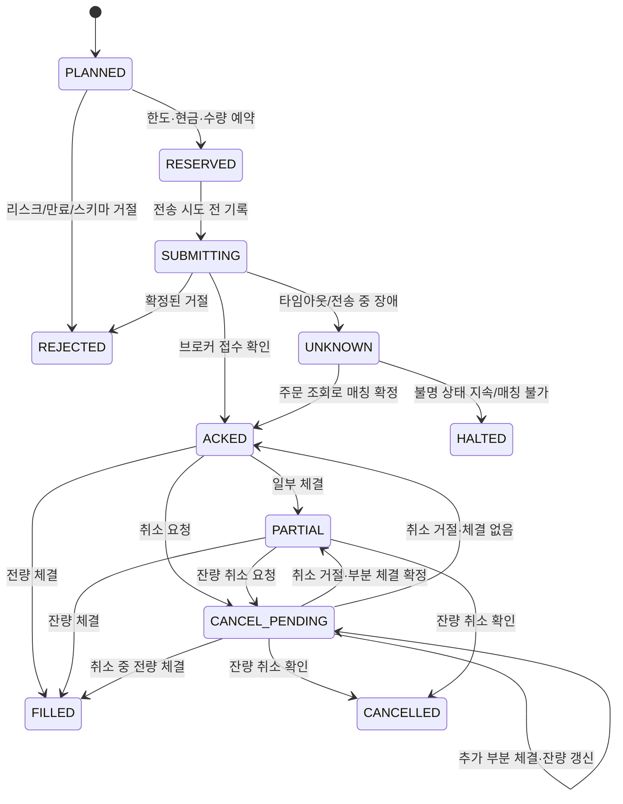

**시스템 설계 — 검증 가능한 자기 개선과 한투 주문 집행**

이 설계는 국내 주식·ETF의 일봉/스윙, 현금 매수, 사람이 승인하는 실거래 승격을 기본 가정으로 한다. 시장·주기·자율성에 대한 사용자 선택은 아직 확정되지 않았다. 아래 구성은 구현 제안이며 실험 결과가 아니다. 원천 근거와 제한은 [조사 문서](01-research.md)에 있다.

**목표의 정의.** 자기 개선의 단위는 버전이 부여된 전략 후보다. 에이전트가 실패 원인을 가설로 만들고, 변경을 한정해 실험하며, 독립 평가 결과에 따라 기존 운영 버전보다 나은 후보만 승격한다. 새 후보가 없거나 증거가 부족하면 운영 버전을 유지한다. 수익률의 지속 상승을 보장하는 시스템으로 정의하지 않는다.

개선 영역은 세 가지로 구분한다.

| 영역 | 자동화 범위 | 증거 | 변경 경계 |
| --- | --- | --- | --- |
| 전략 | 특징·룰·파라미터·모델 후보 생성 | 비용 차감 후 시간순 검증·실시간 관찰 | 연구 환경 안에서 실험. 운영 전략은 승격 절차로만 변경 |
| 집행 품질 | 슬리피지·미체결 원인 분석, 실행 설정 개선 제안 | 같은 주문 의도에 대한 체결·취소·지연 기록 | 운영 주문 설정 변경은 별도 검토·버전 관리 |
| 운영 | 데이터·접속·대사 장애 감지, 재연결·정해진 복구 | 지연·불일치·중복·장애 복구 기록 | 사전 정의한 상태 전이만 수행. 리스크 제한 완화는 불가 |

초기 범위는 비레버리지 ETF의 사전 지정 유니버스, 단순 모멘텀 또는 추세 필터 한 개, 현금 대기 상태를 포함하는 포트폴리오다. 신용·공매도·파생상품·호가 기반 초단타와 실거래 중 탐색을 초기 범위에 넣지 않는다. ETF를 먼저 쓰더라도 유동성·상장일·분배금·상품별 세금·상장폐지 문제는 데이터에 반영한다.

**구성 경계.** 연구와 운영은 프로세스·자격증명·쓰기 권한을 분리한다. MVP의 역할들은 단일 오케스트레이터가 순차 실행할 수 있으며 별도의 여러 LLM 에이전트가 필수는 아니다.



| 모듈 | 책임 | 입력 → 출력 |
| --- | --- | --- |
| Data service | 원문 보존, 정규화, 이용 가능 시점·기업행위·휴장일 관리 | 원천 응답 → 승인된 스냅샷 |
| Research orchestrator | 가설 생성, 제한된 실험, 실패·중복 가설 기록 | 개발 데이터·과거 실험 → 후보 manifest·코드/DSL |
| Evaluator | 평가 구간·비용·기준을 소유, 재현 가능한 평가 | 고정 후보·고정 데이터 → 평가 보고서·판정 |
| Strategy runtime | 배포된 로직을 고정 버전으로 실행 | 이용 가능한 데이터·현재 상태 → 목표 비중 |
| Portfolio/Risk | 목표 비중을 실제 수량으로 변환, 계좌 전체 한도 적용 | 목표 비중·잔고·호가·미체결 → 허용/거절된 주문 의도 |
| OMS/KIS adapter | 전송·접수·체결·취소·불명 상태 처리 | 승인된 의도 → 브로커 주문·상태 이벤트 |
| Reconciler/Ledger | 체결·현금·보유 수량의 정합성, 손익 귀속 | 브로커 조회·WS·수동 거래 → 원장·불일치 알림 |
| Release registry | 아티팩트·승인·정책 버전·활성 버전 관리 | 평가·승인 → 배포 허용 목록 |

LLM은 연구·코드 리뷰·보고서 생성에 사용한다. 실시간 주문 경로는 정형 데이터와 검토된 코드로 수행한다. 자연어의 매수 제안이나 스킬의 설명 문장은 주문 승인으로 해석하지 않는다.

**데이터 계약.** 최소 키는 instrument_id, venue, session_date, event_time, available_at, ingested_at, source, revision, data_snapshot_id다. 분봉·일봉은 시작/종료 시각과 확정 여부를 함께 저장한다. 시간 저장은 UTC, 거래일·세션 판정은 Asia/Seoul을 사용한다.

- available_at은 해당 값이 확정되고 실제 이용 가능해진 시각이다. event_time과 다를 수 있다. available_at <= decision_time 조건을 데이터 접근 계층에서 강제한다.
- 수정주가와 원주가를 분리한다. 신호 계산의 조정 가격과 실제 주문·평가의 원주가를 혼용하지 않는다. 분할·병합·분배금은 별도 이벤트로 처리하고 미래에 생긴 조정 정보를 과거에 부당하게 노출하지 않는다.
- 과거 유니버스는 그때의 상장·편입·거래 가능 여부로 재구성한다. 현재 살아 있는 ETF·지수 구성종목만으로 과거 성과를 주장하지 않는다. 데이터가 없으면 제한을 표시하고 유니버스를 미리 고정한 전진 검증으로 전환한다.
- API 일봉 조회는 구간 분할, 중복 제거, 누락 거래일·가격 급변·거래량 검사, 재수집 체크포인트를 지원한다. 같은 데이터의 조용한 덮어쓰기는 금지하고 수정 이력을 남긴다.
- 재무·뉴스를 추가할 경우 최초 공표일·수정일·원문 식별자를 저장한다. 최신 검색 결과를 과거 날짜의 뉴스처럼 사용하지 않는다. 과거 백테스트에서 LLM 사전학습 지식의 미래 정보 오염까지 완전히 차단하기 어려우므로, 초기 전략 판단은 수치형 데이터로 제한하고 LLM 리서치 기여는 전진 검증에서 별도로 평가한다.
- 에이전트의 기억도 시점을 갖는다. 특정 과거 날짜를 평가할 때 이후 거래 결과·사후 분석·미래 체결을 검색하지 못하도록 접근 계층에서 차단한다.

권장 저장은 Parquet + DuckDB로 연구 데이터를 다루고, PostgreSQL로 주문·체결·현금 예약·아웃박스·실험 메타데이터를 관리하는 구성이다. 모델·리포트는 콘텐츠 해시가 있는 파일/오브젝트 스토리지에 보존한다. 대규모 스트리밍이나 벡터 DB는 초기 필수 요소가 아니다.

**전략 계약.** 전략은 직접 주문하지 않고 다음 형태의 결정만 출력한다. 비중의 합이 1보다 작으면 나머지는 현금이다. confidence를 통계적으로 보정하지 않았다면 성공 확률로 표시하지 않는다.

```yaml
decision:
  strategy_version: immutable-artifact-hash
  decision_time: timestamp
  data_snapshot_id: snapshot-id
  universe_version: approved-universe-id
  target_weights: {instrument_id: weight}
  valid_until: timestamp
  reason_codes: [rule-or-model-output-id]
```

초기 후보 정의는 .kis.yaml을 교환 형식으로 검토하되, 내부 CandidateManifest를 기준 계약으로 삼는다. 공식 DSL과 내부 확장의 변환·왕복 보존을 검증한다. 지원되지 않는 필드는 조용히 버리지 않고 거절한다. 포트폴리오 목표 비중, 실험 구간, 비용 모델, 위험 정책 참조, 코드·데이터 해시는 별도 manifest에 둔다. 임의 Python 실행은 연구 샌드박스에서만 허용하고 운영 아티팩트는 검토 후 고정한다.

**자기 개선 루프.**

1. 장 마감 후 데이터 품질·원장 정합성을 확인한다. 문제가 있으면 전략 연구의 성과 해석을 보류하고 운영 장애를 먼저 분류한다.
2. 기존 운영 전략(champion)의 손익을 시장 노출, 신호 효과, 비용·슬리피지, 미체결, 버그로 나눠 분석한다. 손실 한 번을 근거로 전략을 바꾸지 않는다.
3. “회전율이 높은 구간에서 비용 때문에 성과가 악화된다”처럼 반증 가능한 가설 하나와 예상 효과·실패 조건·실험 예산을 등록한다.
4. 후보(challenger)는 원칙적으로 한 번에 한 변경 축만 바꾼다. 허용된 지표·기간·모델 종류·파라미터 범위 안에서 생성하고 중복 후보는 해시로 제거한다.
5. 코드·스키마·시간 정렬·재현성 검사를 통과한 후보만 개발 구간에서 실험한다. 실패·중단·버린 후보도 전체 시도 수에 포함한다. 최초 실험 예산은 작은 수로 설정하고 변경 이력에 남긴다.
6. 개발 구간에서 선택한 후보를 고정한 뒤 독립 평가기가 최종 미사용 구간을 평가한다. 연구 프로세스는 최종 구간 원문과 평가 코드를 수정할 수 없다.
7. 기준 미달이면 기존 전략을 유지한다. 최종 구간 결과를 본 뒤 후보를 수정했다면 그 구간은 이미 소비된 데이터로 표시하고 새 독립 구간 또는 미래 관찰을 기다린다. 같은 구간을 반복해 통과할 때까지 최적화하지 않는다.
8. 통과 후보는 실시간 shadow와 한투 모의투자로 운영 적합성을 확인한다. 승인된 아티팩트만 소규모 실거래 단계로 이동한다.
9. 관찰 결과는 수치·출처·표본 수·반증 조건과 함께 기억에 저장한다. LLM의 사후 설명은 다음 실험의 가설이며 검증된 법칙이 아니다.

권장 주기는 일일 운영 리뷰, 주간 후보 연구, 충분한 증거가 쌓였을 때의 승격이다. 데이터가 부족하면 승격을 건너뛴다. 모델 재학습, 파라미터 변경, 코드 변경은 각각 새 버전이며 같은 검증 계약을 적용한다. 초기에는 LLM 자체의 파인튜닝이나 실계좌 강화학습보다 검증된 전략 후보를 축적하는 데 집중한다.

**평가 계약.** 기존 전략, 현금, 같은 유니버스의 단순 기준 포트폴리오를 함께 비교한다. 위험 예산·비용·실행 지연·초기 자본·투자 가능 유니버스는 비교군 사이에서 일치시킨다. 더 많은 위험이나 회전율로 얻은 수익을 개선으로 보지 않는다.

| 단계 | 평가 내용 | 통과 조건 |
| --- | --- | --- |
| 정합성 | 데이터 시점, 미래 참조, 수량·가격·수수료·기업행위, 결정 재현 | 중대 오류 없음, 동일 입력으로 동일 결정·기록 재현 |
| 개발 검증 | 시간순 rolling/expanding walk-forward, 파라미터 선택의 안쪽 구간 분리 | 사전 정의 기준 충족, 특정 구간·종목 한 곳에 의존하지 않음 |
| 최종 검증 | 후보를 고정한 후 미사용 기간 평가, 위험 일치 비교 | 최소 경제적 개선폭과 불확실성 기준 모두 충족. 부족하면 보류 |
| 비용 스트레스 | 실제 상품별 비용, 슬리피지 확대, 지연·부분 체결·미체결 | 낙관적 체결 가정에서만 우월한 후보는 탈락 |
| 실시간 검증 | shadow 결정, 모의 주문·취소·재시작·대사 | 운영 불변조건 충족, 관찰 기간·사건 수 기록 |
| 소규모 실거래 | 실제 체결 비용·운영 손실·드리프트 | 승인한 한도와 관찰 기준 유지. 자동 증액은 초기 범위 밖 |

주요 보고 지표는 비용 차감 수익률, 기준 대비 초과수익, 변동성, 최대낙폭, 회전율, 익스포저, 거래·독립 시간블록 수, 체결률, 구현 손실(implementation shortfall), 비용·LLM 사용료다. 승률 하나나 LLM의 자신감으로 승격하지 않는다.

평가 기간·개선 최소폭·허용 낙폭·회전율은 실험 전 고정한다. 결과의 불확실성은 일별 수익의 자기상관을 고려한 paired block bootstrap 같은 방법으로 비교하되, 짧은 표본에서는 “판단 불가”가 가능해야 한다. 다중 실험의 선택 편향을 전체 시도 수와 함께 보고하고 필요하면 검증된 DSR/PBO를 보조 지표로 사용한다. 임의의 Sharpe 임계값 하나를 보편적인 합격 기준으로 두지 않는다.

라벨이 여러 날의 미래 수익을 사용하면 경계에 걸친 훈련 라벨을 purge한다. embargo/gap은 라벨·의존성 구조에 따라 정한다. 개발 중 재사용한 validation은 최종 독립 OOS로 부르지 않는다. CPCV는 보조적인 과최적화 진단에 사용하고 최종 배포 모사는 과거→미래 순서를 따른다.

일봉 전략의 종가 신호는 해당 종가가 확정된 뒤 생성한다. 주문은 다음 거래 세션의 사전 지정 실행창에서만 보낸다. 익일 시가+고정 슬리피지 같은 일봉 모델은 초기 후보 선별용 근사다. 최종 집행 평가는 실제 실행창의 분봉/호가 재생 또는 전진 체결 기록으로 보완하고, 서로 다른 시점의 가상 체결을 실거래와 같은 성과로 표시하지 않는다. 지정가가 일봉 고저가 사이에 있었다는 사실만으로 체결을 보장하지 않는다.

4~8주 정도의 모의투자는 운영 안정성 관찰의 계획 예시일 뿐, 저빈도 전략의 수익성 증거가 충분하다는 기준은 아니다. 저빈도·상관된 ETF에서는 긴 기간이 지나도 독립 표본이 적을 수 있다. 수익성 판정은 데이터·시장 국면·효과 크기와 불확실성에 따른다.

**한투 어댑터.** 초기 구현은 REST 시세·주문·조회, WebSocket 체결 통보, 주기적 REST 대사를 결합한다. WebSocket은 빠른 업데이트 경로이며 완전한 원장의 유일한 근거로 두지 않는다. 연결 재수립 후 잔고·주문·체결을 조회해 누락을 복구한다.

| 어댑터 기능 | 공식 예제 경로/함수 | 처리할 계약 |
| --- | --- | --- |
| 인증 | kis_auth.py, auth_token, auth_ws_token | 환경별 키·토큰 저장소·만료·재발급 동시성 |
| 가격·일봉 | inquire_price, inquire_daily_itemchartprice | 수정주가 구분, 구간 분할, 시세 신선도 |
| 현금 주문 | order_cash | 환경·거래소·주문 유형·가격·정수 수량·접수 결과 |
| 정정·취소 | order_rvsecncl | 원주문 번호·조직번호·잔량·취소 확정·체결 경합 |
| 주문·미체결 조회 | inquire_daily_ccld, inquire_psbl_rvsecncl | 연속 조회, 누락·중복, 주문 상태 |
| 잔고·매매 가능 | inquire_balance, inquire_psbl_order, inquire_psbl_sell | 현금·미체결 예약·매도 가능 수량·외부 거래 |
| 체결 통보 | ccnl_notice | 환경별 WS TR ID, 중복·역순·재연결·누락 보완 |

어댑터 내부에는 환경·API별 계약 맵을 한 곳만 둔다. 실전/모의 base URL, 인증키, 계좌, TR ID, 거래소를 일관된 config bundle로 검증하고 교차 조합을 시작 시 거절한다. API 성공 응답은 주문 접수이며 체결 완료와 구분한다. HTTP 상태와 업무 응답코드를 함께 검사한다.

계정·환경별 공유 rate limiter를 사용하고, 체결 확인·취소·대사를 대량 시세 수집보다 우선 처리한다. 토큰은 응답의 만료 시각에 따라 재사용하고 갱신은 한 작업만 수행한다. 조회는 제한된 backoff 재시도가 가능하지만 주문은 아래 불명 상태 처리 규칙을 따른다. API 키를 프롬프트·로그·실험 산출물에 넣지 않는다.

초기는 KRX 정규장으로 제한하고 NXT/SOR·시간외 거래는 별도 기능으로 둔다. 휴장·동시호가·VI·거래정지·가격제한·상품별 호가 단위·매매 가능 여부는 설정·캘린더·현재 시장 상태로 판단한다. 현재가가 없거나 오래됐으면 신규 주문을 보류한다.

**OMS와 원장.** 로컬 중복 방지 키는 계좌·전략 버전·의사결정 시각·종목·리밸런스 식별자로 만들고 DB unique 제약을 둔다. 이 키를 브로커가 지원하는 native idempotency key라고 가정하지 않는다. 계좌별 하나의 활성 작성자와 DB lease/fencing으로 경쟁 주문을 막고, 주문 의도·현금/수량 예약·전송 아웃박스를 한 트랜잭션으로 기록한다.



핵심은 전송 이후 응답이 없다고 주문이 없었다고 추정하지 않는 것이다. UNKNOWN은 거절이 아니다. 동일 주문을 즉시 재전송하지 않고 주문·체결·잔고를 조회한다. broker order id, 원주문 관계, 계좌·종목·시간·수량 등의 근거로 확정적으로 매칭할 수 없으면 신규 노출을 정지하고 수동 확인 대상으로 남긴다. 재조회에 나타나지 않는 것만으로 미접수를 확정하지 않는다.

취소 요청을 보낸 뒤에도 체결될 수 있다. 최종 누적 체결량과 취소된 잔량을 각각 기록하며, CANCELLED에도 이미 체결된 수량이 남을 수 있다. 예약 금액·수량은 확정된 체결과 잔량 상태를 확인한 뒤 해제한다. 상태 머신은 요약이며 미체결 만료·일자 전환·역순 통보도 원장 이벤트로 처리한다.

분산 네트워크에서 브로커까지의 exactly-once 실행을 보장한다고 주장하지 않는다. 로컬 unique 제약, 단일 작성자, 지속 저장, 불명 상태 격리, 반복 대사로 중복 주문의 가능성과 영향을 관리한다. 프로세스가 어느 전송 단계에서 죽어도 재시작 후 먼저 대사한다.

보유 수량은 정규화한 브로커 상태·체결·기업행위와 내부 원장을 대조해 검증한다. 수동 거래나 입출금도 감지한다. 차이가 해소되지 않으면 전략 신호보다 대사를 우선한다. 전용 계좌 또는 구분 가능한 전략 슬리브를 권장하며, 손익에서 입출금을 수익으로 계산하지 않는다.

**고정 리스크 게이트.** 위험 정책은 연구 에이전트의 변경 권한 밖에 둔다. 다음 한도는 사용자 자본·운영 목표에 따라 별도 설정하고 승인 전 실거래를 차단한다. 설계에서 임의 손실률을 사용자 한도로 확정하지 않는다.

- 승인한 계좌·상품·거래소·세션·전략 버전인지 확인한다.
- 종목·섹터/기초자산·총 노출, 종목별 주문 규모, 일일 회전율, 유동성 대비 참여율을 검사한다. 상관된 ETF를 서로 독립적인 노출로 간주하지 않는다.
- 미체결 주문과 동시 주문을 포함한 예상 노출, 수수료를 포함한 가용 현금, 실제 매도 가능 수량을 예약·검증한다.
- 목표 비중을 정수 수량·호가 단위로 반올림한 최종 주문에 다시 한도 검사를 수행한다. 오래된 계획은 실행 시점에 재검증한다.
- 실현·미실현 손익, 현금흐름을 보정한 드로다운, 데이터 지연, 대사 차이, 비정상 거절률에 따른 정지 정책을 둔다.

정지 상태는 신규 노출 확대를 막는다. 미체결 진입 주문은 취소 결과를 확인하며, 보유 포지션의 축소·긴급 청산은 사전에 승인한 정책과 신선한 시장·계좌 상태 아래에서만 수행한다. 연결 장애나 가격 급변 중의 시장가 전량 청산을 보편적인 복구 동작으로 두지 않는다. 킬 스위치가 손실을 정확한 금액에서 제한한다고 보장하지 않는다.

**배포와 롤백.** 후보는 DRAFT → VALIDATED → SHADOW/PAPER → APPROVED → CANARY → ACTIVE → RETIRED 상태로 이동한다. 승인 기록에는 코드·모델·데이터·비용·리스크·실행 설정의 해시를 묶는다. 승인 이후 파일 하나라도 바뀌면 새 후보다. 연구 코드가 활성 버전 포인터나 위험 정책을 변경할 수 없다.

운영 배포는 주문이 없는 통제 시점에 수행하고, 재시작·대사·호환성을 점검한다. canary 자본과 노출·중단 조건은 배포 전에 확정한다. 모델 드리프트나 성과 하락은 조사·정지·축소의 신호이며 자동 위험 확대의 이유가 아니다.

롤백은 먼저 신규 의사결정을 정지하고 미체결·현금·보유 수량을 대사한 뒤 이전 아티팩트를 복구하는 절차다. 이전 버전을 켜는 것만으로 현재 포지션이 이전 상태로 되돌아가지 않는다. 포지션 전환 계획을 새 주문 의도로 생성하고 같은 리스크·OMS 경로를 거친다.

**에이전트 스킬 설계.** 외부 스킬을 설치하는 것보다 프로젝트 계약에 맞는 작은 SKILL.md를 작성하는 쪽을 권장한다. 아래는 향후 구현할 사양이며 현재 등록·설치한 스킬은 아니다. 권한은 프롬프트 문구가 아니라 서비스·DB·자격증명 계층에서 제한한다.

| 제안 스킬 | 입력 | 허용 도구 | 필수 출력·실패 조건 |
| --- | --- | --- | --- |
| kis-api-research | 원하는 API 기능·환경 | 고정 공식 문서·샘플 조회 | 출처·필드·환경별 계약·미확인 항목. 계약 충돌 시 추측 금지 |
| market-data-audit | 데이터 스냅샷·캘린더 | 읽기 전용 데이터 검사 | 누락·조정·시점·유니버스 QA 보고서. 중대 오류 시 평가 보류 |
| strategy-research | 개발 데이터·과거 실험·예산 | 제한된 특징 계산·후보 파일 작성 | 가설·변경 축·반증 조건·manifest. 미래/봉인 데이터 접근 불가 |
| backtest-review | 고정 후보·평가 보고서 | evaluator 조회·진단 | 기준 대비 차이·불확실성·비용 스트레스. LLM이 수치를 재작성하지 않음 |
| execution-reconcile | 주문·체결·잔고의 읽기 전용 뷰 | 대사 조회·중지 요청 | 불일치 근거·복구 계획. 임의 추가 주문 권한 없음 |
| promotion-review | 평가·운영 증거·버전 해시 | 검토 보고서·승인 요청 생성 | 승인 대상 묶음·남은 결함. 자체 실거래 승격 권한 없음 |

웹 문서·뉴스·README·거래 메모는 데이터로 다룬다. 그 안의 지시가 도구 권한을 바꾸지 못하도록 한다. 생성 코드는 자격증명·운영 DB·외부 네트워크가 없는 제한된 샌드박스에서 CPU·메모리·시간 예산 아래 평가한다. 연구 환경이 데이터를 읽는 경로와 평가자가 최종 구간을 읽는 경로도 분리한다.

**최소 기술 구성.** Python 3.11/3.12 중 채택 컴포넌트와 맞는 버전 하나를 고정하고 uv로 의존성을 잠근다. pandas/Polars 중 하나, Parquet/DuckDB, PostgreSQL, Lean 평가 어댑터, 구조화 로그, 파일 기반 아티팩트 저장소로 시작한다. Python 작업 큐·스케줄러와 간단한 운영 API/CLI면 충분하다. MLflow·Optuna·LangGraph는 각각 실험 수·탐색 공간·중단 재개 복잡성이 커질 때 추가한다. 운영 자격증명이 들어간 컨테이너에 연구용 코드 실행 권한을 주지 않는다.

**시장·자율성 변경 시의 차이.** 분봉/장중 매매를 선택하면 주문장·틱/분봉 저장, 더 높은 시계 정밀도, 세션·VI 이벤트, 지연·유동성 모델과 이벤트 엔진을 우선한다. 미국 주식은 거래소·통화·환전·정산·DST·휴장일·주문 가능 세션을 별도 계약으로 둔다. 파라미터만 자동 조정하려면 허용 범위와 갱신 주기를 고정하고 같은 평가·승격 절차를 적용한다. 완전 자동 배포를 원하면 이후 검증된 정책에 한해 서명된 게이트로 승인자를 대체할 수 있으나, 위험 정책·주문 엔진·평가 코드는 자기 수정 범위 밖에 둔다.
