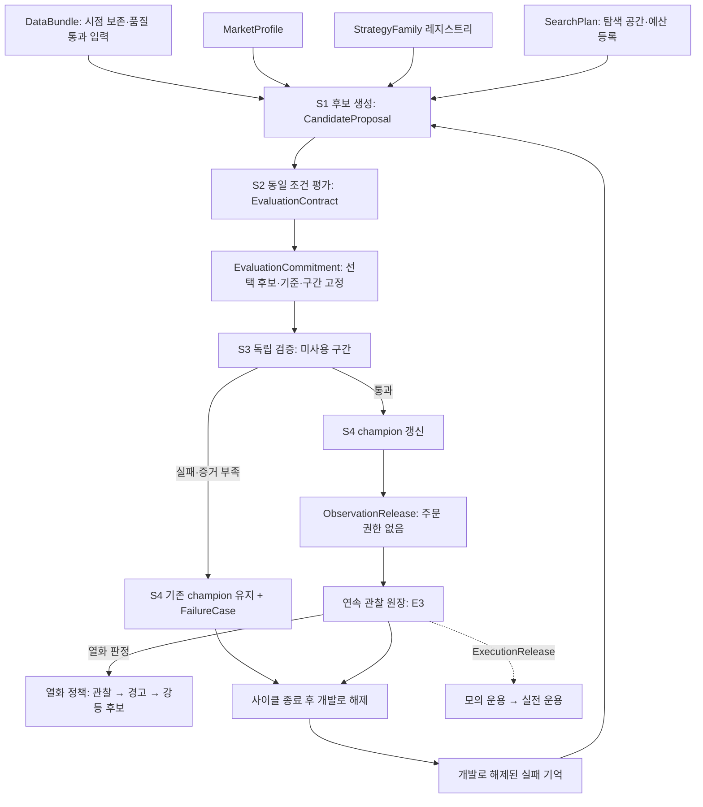

# 자기 개선 자동 트레이딩 에이전트 — 기준 블루프린트 v1.1

작성일: 2026-10-16 KST. 코드 기준: `74e07e9`, 작업 범위 기준: `577fede`. v1.1은 v1.0을 **4단계 자기 개선 루프** 중심으로 재구성하고, 수치와 계약을 `79d9c01` 시점의 코드와 다시 대조한 문서 변경이다. 런타임 기능은 추가하지 않았다. 목표 기능과 실제 구현은 [진행 현황](status.md)에서 구분한다.

**C1~C4 구현 갱신:** 평가 계약 ID·동일 조건 검사, 거래 가능성 수량 단계·reference_price 지표, 현금/적격 동일 비중 보고, opt-in 통계 v2·합성 진단 도구를 구현했다. 기본 v1 승격·일정·소비 규칙은 유지한다. [구현 보고](batch1-implementation.md)와 [현황](status.md)이 최신 구현 근거다.

## 1. 목표

시장별 후보 선정과 전략으로 매매 후보를 만들고, 아래 네 단계를 반복해 검증된 전략만 갱신하는 에이전트를 만든다.

| 단계 | 목표 | 핵심 계약 |
| --- | --- | --- |
| **S1 후보 생성** | 시장별 필터와 전략으로 후보를 만들고, 개발 데이터에서 개선 가설을 제안한다 | 제안기는 개발 구간 데이터와 **개발로 해제된** 실패 기억만 읽는다 |
| **S2 동일 조건 평가** | 공통 체결·회계 엔진으로 비용 차감 성과, 낙폭, 거래 가능성을 비교한다 | 같은 `EvaluationContract` ID를 가진 결과끼리만 비교한다 |
| **S3 독립 검증** | 탐색 범위와 합격 기준을 고정한 뒤 아직 사용하지 않은 평가 구간에서 확인한다 | 최종 후보까지 고정(commitment)한 뒤 평가가 시작되고, 증거 등급(§5)을 남긴다 |
| **S4 전략 갱신·추적** | 통과한 후보만 해당 시장·전략군의 champion으로 갱신하고 새 데이터에서 추적한다. 실패하면 기존 전략을 유지한다 | champion 키는 `(market, strategy_family)`다 |

연구 champion은 곧바로 계좌를 움직이지 않는다. 운용은 두 단계 Release 계약(§6)을 거친다: 주문 권한 없는 관찰 등록(`ObservationRelease`) → 실행 자격(`ExecutionRelease`, 모의 → 실전).

사용자가 정한 범위:

| 항목 | 적용 결정 |
| --- | --- |
| 시장 | 첫 구현은 KRX/KRW 국내 주식·ETF(기본 KOSPI/KOSDAQ). 계약은 시장과 무관하게 정의한다 |
| 자본 | 연구 상한 1,000,000원. 실계좌의 기존 보유·미체결을 포함한 주문 상한 집행은 후속 개발 |
| 우선순위 | 후보 선정 → 전략 로직 → 자동 개선 → 실제 데이터의 전진 검증 → 주문 연결 |
| 미국 H1~H4 | 사용자 재개 지시 전까지 개발·연구 실행 보류. 코드·설정·골든은 보존 |
| 공통 회계 | 기존 원장을 재사용·유지. 미국 가설 연구 재개와는 별개 |
| 전략 갱신 권한 | 연구 champion만 자동 갱신. 브로커 주문·활성 실전 전략을 자동 변경하지 않음 |

위 우선순위는 **제품 가치의 순서**다. 실제 작업 순서는 선행 조건(데이터 → 경제 평가 → 검증 → 운영)을 따르며 §9에서 정한다.

## 2. 루프 전체 그림



현재 실제 실행 경로는 `momentum.agent` → KIS `SelectionEngine`/계획 함수 → 공통 `Ledger` → 연구 저장소다. 위 그림에서 `DataBundle`, `MarketProfile`, `StrategyFamily`, `SearchPlan`, `EvaluationCommitment`, 실패 기억 해제, 연속 관찰 원장, 열화 정책, `ObservationRelease`/`ExecutionRelease`는 설계안이며 아직 구현되지 않았다.

## 3. 루프 불변식

어느 단계의 구현을 바꾸더라도 아래 규칙이 깨지면 루프의 결론이 틀린다. 불변식마다 실패하는 회귀 테스트를 하나 이상 둔다.

| ID | 불변식 | 현재 근거 |
| --- | --- | --- |
| INV-1 | 제안기(S1)는 **진행 중인 사이클이거나 아직 개발로 해제되지 않은** 최종 검증·추적 결과를 입력으로 받지 않는다. 해제는 사이클이 끝난 뒤 명시적 기록으로만 일어난다(§5) | 개발 prefix만 전달(`service._evaluate`), 회귀 11. 해제 기록은 미구현 |
| INV-2 | 모든 후보는 같은 `EvaluationContract`(평가 구간·자본·위험 한도·초기 포트폴리오·실행 시계·비용·체결·원장)로 평가한다. 전략의 의사결정 주기는 후보 쪽 변수다 | `CommonEvaluator`, `EvaluationContract` ID, `require_same_contract`(C2 합성 회귀) |
| INV-3 | 최종 후보 spec·기준 전략·합격 기준·구간은 평가 구간의 첫 실행 시각 전에 고정된다 | 평가 전 manifest 저장(회귀 09, 20). 첫 실행 시각 전 고정은 미구현 |
| INV-4 | 한 번 쓴 최종 검증 구간은 같은 시장에서 다시 최종 검증에 쓰이지 않는다. 개발로 해제돼도 마찬가지다. 최종 검증 소비는 배타적이고, 관찰 노출과의 동시 사용은 구간 시작 전에 등록한 검증 cohort 안에서만 허용한다 | `agent_intervals`, legacy `holdouts`(회귀 05, 12, 13, 15, 16). 현재는 용도와 상관없이 모든 겹침을 거부. cohort는 미구현 |
| INV-5 | 실패·동점·증거 부족은 champion을 바꾸지 않는다 | `promotion_gates`, 회귀 04, 08 |
| INV-6 | 정책(위험 한도·비용·합격 기준)은 연구 안에서 바뀌지 않는다. 바꾸면 새 정책 버전이고, 그 정책의 예산은 예산 계정에서 **명시적으로 할당**한다(새 예산을 그냥 만들지 않음) | `AgentPolicy` 동결, `build_id` |
| INV-7 | 예산 소비 기록은 연구 이름·빌드·정책·family 버전을 바꾸거나 실행을 폐기해도 사라지거나 초기화되지 않는다 | 연구 단위 예산(최대 8 사이클)만 구현. `budget_account_id` 단위 누적은 미구현 |
| INV-8 | 연구 champion은 주문 권한을 갖지 않는다 | `orders_submitted: 0`, `promotion_authority: false` |

회귀 번호는 [진행 현황](status.md) §6의 `tests/unit/test_agent.py` 번호다.

## 4. 단계별 명세와 현재 위치

각 단계의 계약 필드는 [루프 계약 설계안](loop-contracts.md)에 있다.

### S1 후보 생성

| 항목 | 내용 |
| --- | --- |
| 입력 | `MarketProfile`, `StrategyFamily`, `SearchPlan`, 현재 champion, 개발 구간 `DataBundle`, 개발로 해제된 실패 기억 |
| 출력 | `CandidateProposal` 목록(파라미터·가설·반증 조건·조상), 선정/제외 사유 |
| 현재 | KRX 고정 필터(`selection.py`), 전략군 1개(`RankedStrategy`), lookback {5,10,20} × ranking 3개 고정 grid(challenger 8개) |
| 차이 | 시장 추상화 없음: `AgentPolicy`가 KRX/KRW 외를 거부하고 장 시각(09:00/15:30/16:00)이 코드에 고정. 전략군 레지스트리 없음. 리밸런싱 주기가 "매 세션 재선정"으로 암묵 고정. 제안은 가설이 아니라 grid 열거 |
| 작업 | LOOP-01, LOOP-02, LOOP-08, RES-04, RES-05 |

### S2 동일 조건 평가

| 항목 | 내용 |
| --- | --- |
| 입력 | 후보 spec(의사결정 주기 포함), `EvaluationContract`(평가 구간·데이터 묶음·자본·위험 한도·초기 포트폴리오·실행 시계·비용·체결·원장 버전) |
| 출력 | `EvaluationResult`: 비용 차감 수익, 낙폭, 회전율, **거래 가능성 지표**, 거래/자산 곡선 |
| 현재 | 공통 평가기, 전일 종가 기준 수량 계획, 다음 시가 체결, 전일 거래량 1% 상한, 비용 1.5/20/5bps, 수수료·slippage 2배 스트레스 |
| 차이 | C1/C2의 계약 ID·수량 단계·reference_price 지표, C3의 현금/적격 동일 비중 및 후속 opt-in 시장 ETF 보고 구현(합성 회귀). 기준 전략 gate·capacity·실데이터 경제 검증은 후속 |
| 작업 | LOOP-03, RES-01, FIN-01~04 |

### S3 독립 검증

| 항목 | 내용 |
| --- | --- |
| 입력 | 개발에서 선택된 후보 1개, `EvaluationCommitment`, 미사용 구간 데이터 |
| 출력 | gate 결과, 신뢰구간, 증거 등급(§5), 소비 기록 |
| 현재 | 고정 일정(개발 120 / 격리 5 / 최종 40), 시장 단위 소비, 승격 조건 10개, paired circular block bootstrap + 사이클 예산 Bonferroni |
| 차이 | 후보 선택과 고정이 구간 **도착 후·계산 전**에 일어나므로 증거 등급은 E1까지만 가능. 예산이 연구 단위. C4의 opt-in 통계 v2·합성 민감도 도구를 구현했으나 실제 오류율 검토와 개발 구간 블록 선정 근거는 미완료([자기 개선](self-improvement.md) §6) |
| 작업 | RES-02, RES-03, LOOP-07 |

### S4 전략 갱신·추적

| 항목 | 내용 |
| --- | --- |
| 입력 | S3 결과, champion 레지스트리, 새 데이터 |
| 출력 | champion revision 또는 유지 기록, `FailureCase`, `ObservationRelease`, 연속 관찰 원장, 열화 상태 |
| 현재 | 연구(study) 단위 champion, 사이클마다 별도 초기 자본으로 새로 시작하는 20세션 shadow 블록, 열화 flag(낙폭 초과 또는 기존 전략보다 낮은 수익)만 기록 |
| 차이 | champion 키가 `(market, strategy_family)`가 아님. 관찰이 사이클을 넘어 이어지지 않음(20세션 초기화 블록을 이어 붙여도 연속 NAV가 되지 않음). 유지 사이클에서는 `champion_before == champion_after`라 shadow가 같은 전략끼리 비교함(순우위 항상 0). 열화 판정에 따른 상태 전이 없음 |
| 작업 | LOOP-04, LOOP-05, LOOP-06, LOOP-08, LOOP-09, OPS-05, OPS-06 |

**두 원장의 구분.** S2·S3의 **실험 원장**은 후보마다 같은 초기 조건(자본·빈 포트폴리오)으로 다시 시작해 비교 가능성을 지킨다. S4의 **관찰 원장**은 revision이 바뀌어도 현금·보유·배당채권을 이어 가며, 전략 교체에 드는 실제 거래와 비용을 기록한다. 관찰 원장의 자산은 실제 거래·비용·기업행동 외에는 불연속이 없어야 한다.

## 5. 검증 증거 등급

"아직 사용하지 않은 구간"을 세 등급으로 나눈다. 보고서와 champion 기록에는 등급을 함께 남긴다.

| 등급 | 의미 | 판정 조건 | 현재 |
| --- | --- | --- | --- |
| **E1** 예약 과거 구간 | 이미 받아 둔 자료 안에서, 이 시장에서 소비되지 않은 구간 | 최종 후보와 기준을 계산 전에 고정 | **구현됨** |
| **E2** 사전 고정 신규 구간 | 최종 후보까지 고정한 **뒤에** 실제로 발생한 기간 | `EvaluationCommitment` 저장 시각 < 평가 구간의 **첫 실행 시각**(첫 수익이 형성되기 시작하는 주문 체결 시각, KRX 일봉 전략은 첫 세션 09:00 개장). 그리고 평가 구간의 모든 세션이 저장 시각 이후에 열림 | 미구현(RES-03) |
| **E3** 실시간 관찰 | `ObservationRelease`로 고정한 버전이 실시간으로 쌓은 관찰 | 고정 버전·데이터 노출 조건을 함께 기록 | 미구현(OPS-06) |

E2로 인정하지 않는 경우: 개장 후(장중 결과를 볼 수 있는 시각)에 고정한 경우, 평가 기간이 시작된 뒤 후보·기준·합격 기준을 바꾼 경우, 이미 발생한 과거 기간의 자료를 늦게 수집하거나 정정 공개를 받은 경우.

정책:

- 연구 champion 갱신은 E1 이상에서 허용하되, 등급을 champion 기록에 남긴다.
- `ObservationRelease`(주문 권한 없음)는 E2 통과 기록을 요구한다. 사전 E3 기록은 요구하지 않는다.
- `ExecutionRelease`(모의·실전)는 그 관찰 버전의 E3 관찰 기록을 요구한다.
- 등급은 **어떤 조건으로 고정됐는지**를 나타낼 뿐 증거의 세기 순위가 아니다. E3는 실시간이라는 이유만으로 E2보다 강한 독립 증거로 보지 않으며, 관찰 기간·노출 조건을 함께 본다.
- LLM이나 학습 모델이 과거 시장을 알 수 있으므로, 모델 기반 제안의 E1 결과를 E2로 올려 부르지 않는다.

**개발로의 해제와 구간 재사용.** 끝난 사이클의 최종 구간과 shadow 구간은 다음 사이클의 **개발** 데이터가 될 수 있다. 현재 기본 일정에서 사이클 1의 최종 187~226과 shadow 227~246은 사이클 2의 개발 127~246에 포함된다. 이 재사용은 다음 규칙을 따른다.

- 해제 단위는 사이클 상태가 아니라 **확정된 결과 snapshot**(구간, 마지막 반영 세션, 결과 해시, 봉인 시각)이다. 최종 결과는 최종 결정이 확정된 뒤, 관찰 결과는 종료·봉인된 구간이나 checkpoint만 해제한다. 열린 관찰 구간은 사이클이 COMPLETE여도 해제하지 않는다([루프 계약](loop-contracts.md) §9).
- 해제는 `released_to_development_at`을 기록해야 일어난다. 메타데이터에 적는 것만으로 읽기 권한이 생기지 않는다. 제안기는 `eligible_for_proposer = true`인 snapshot만 읽고, 해제된 snapshot은 이후 관찰 갱신으로 바뀌지 않는다.
- 해제된 자료로 만든 후보는 **완전히 새로운** 평가 구간에서 검증한다. 해제된 구간은 다시 최종 검증에 쓰지 않는다(INV-4).
- 현재 shadow 구간은 `agent_intervals`에 시장 단위 소비로 기록되므로, 같은 DB의 다른 연구는 그 구간을 최종 검증에 쓸 수 없다.

**관찰과 다음 최종 검증의 동시 사용.** 관찰을 매일 이어 가면서 현재 소비 규칙을 그대로 쓰면, champion 관찰이 다음 challenger의 최종 구간까지 먼저 소비하거나, 반대로 최종 구간 예약이 관찰을 막는다. 그래서 날짜 사용을 배타적인 **최종 검증 소비**와 **관찰 노출**로 나눈다. 둘의 동시 사용은 구간 시작 전에 등록한 **검증 cohort**(단일 challenger + 이미 고정된 관찰 버전) 안에서만 허용한다. cohort 기간의 관찰 결과는 최종 결정이 확정될 때까지 봉인되어 후보 선택·기준 변경·제안기 입력에 들어가지 않는다([루프 계약](loop-contracts.md) §12).

## 6. 연구에서 운용으로: 두 단계 Release

연구 champion은 운용 자격을 자동으로 얻지 않는다. 관찰 등록과 실행 자격을 분리한다.

```text
E2 통과 champion → ObservationRelease(주문 권한 없음) → E3 관찰 → ExecutionRelease(paper → live)
```

| 계약 | 진입 조건 | 고정하는 것 | 중단 조건 |
| --- | --- | --- | --- |
| `ObservationRelease` | E2 통과 기록, 사람 승인 | 전략 spec, selector 정책, 비용·위험 한도, `EvaluationContract` ID, 관찰 시작 포트폴리오 | 열화 상태 DEMOTION_CANDIDATE, 데이터 장애, 사람 중단 |
| `ExecutionRelease` | 해당 관찰 버전의 사전 등록 E3 관찰 기간 충족, 사람 승인 | 위 항목 + `target_mode`(paper/live), 총자본 범위, rollback 대상 | 열화·대사 불일치·주문 상태 UNKNOWN·사람 중단 |

관찰 등록만으로는 주문 권한이 생기지 않는다. 주문 구현(ORD-03, ORD-04)은 여전히 후순위다. 다만 Release 필드를 지금 정해 두어야 S1~S4를 구현하는 동안 나중에 주문 쪽에 필요한 정보(선정 근거, 비용 가정, 증거 등급)를 빠뜨리지 않는다. 단계 전환 조건은 [운영 설계](operations.md) §9에 있다.

## 7. 문서 지도

| 문서 | 확인할 내용 |
| --- | --- |
| **[진행 현황](status.md)** | 단계별 완료·부분·미착수·보류, 코드/테스트 근거 |
| [루프 계약 설계안](loop-contracts.md) | MarketProfile·StrategyFamily·예산 계정·SearchPlan·EvaluationContract·EvaluationCommitment·ChampionRegistry·관찰 원장·열화·실패 기억 해제·Release·구간 예약과 검증 cohort 필드 |
| [상세 구조와 계약](architecture.md) | 현재 모듈, 데이터 경로, 원장, DB, 외부 경계 |
| [자기학습·개선 로직](self-improvement.md) | 현재 알고리즘·수식·일정·승격 조건, 통계 정책, 학습 확장 |
| [세부 개발 계획](implementation-plan.md) | 작업 ID·선행 조건·완료 조건 |
| [운영 설계·절차](operations.md) | 실행·장애·복구·버전 전환·단계 전환 |
| [기존 실행 안내](../automatic-research-agent.md) | 현재 CLI 사용 예와 입력 형식 |

해석 순서: 사용자 범위 → 루프 불변식 → 현재 코드와 검증 증거 → 본 기준 설계 → 과거 설계 문서. 과거 미국 명세나 KIS v0.2~v0.5 문서의 기능을 현재 통합 런타임이 모두 지원한다고 해석하지 않는다. 새 의사결정은 관련 작업 ID·정책 버전·현황을 함께 갱신한다.

## 8. 추적표

| 목표 단계 | 불변식 | 현재 코드 | 회귀(`test_agent.py`) | 남은 작업 |
| --- | --- | --- | --- | --- |
| S1 후보 생성 | INV-1, INV-6 | `selection.py`, `logic.py`, `service._evaluate` | 11, 17 | LOOP-01, LOOP-02, LOOP-08, RES-04, RES-05 |
| S2 동일 조건 평가 | INV-2 | `evaluator.py`, `ledger.py` | 01, 02, 10, 18, 19 | LOOP-03, RES-01, FIN-01~04 |
| S3 독립 검증 | INV-3, INV-4, INV-7 | `service.tick`, `_claim`, `confidence_interval`, `promotion_gates` | 04, 05, 07, 08, 09, 12, 13, 15, 16, 20 | RES-02, RES-03, LOOP-07, LOOP-09 |
| S4 갱신·추적 | INV-4, INV-5, INV-8 | `service._finish`, `_shadow`, `_claim` | 03, 06, 14 | LOOP-04, LOOP-05, LOOP-06, LOOP-08, LOOP-09, OPS-05, OPS-06 |

## 9. 작업 순서

1. **문서 기준선(이번 변경):** 루프 불변식, 증거 등급, 계약 설계안.
2. **비교 계약·기준 전략·지표 `LOOP-01`, `LOOP-03`, `RES-01`, `LOOP-07`:** MarketProfile, EvaluationContract, 거래 가능성 지표, 기준 전략, 통계 정책 v2.
3. **후보 사전 고정과 예산 `RES-03`, `LOOP-02`:** SearchPlan/EvaluationCommitment(E2), 전략군 레지스트리, 예산 계정.
4. **실패 기억 권한 `LOOP-08`, `RES-04`:** 개발 해제 기록, 실패 코드, 제안기 입력 제한.
5. **연속 관찰·Release `LOOP-09`, `LOOP-04`, `LOOP-05`, `LOOP-06`, `OPS-05`:** 구간 예약·동시 사용 정책(검증 cohort)을 먼저 정한 뒤 champion 키, 관찰 원장, 열화 정책, 두 단계 Release.
6. **운영과 학습 `OPS-01~04`, `OPS-06`, `RES-05`, `RES-06`:** 상시 운용, 전진 캠페인, LLM·학습 제안.

**병행:** 실제 시점 데이터와 비용 확인(`DATA-01~06`, `FIN-01~04`)은 2~5와 함께 진행한다. 2~5는 합성 데이터로 먼저 구현·회귀할 수 있으나, 실데이터 검증 완료로 표시하려면 DATA·FIN이 끝나야 한다. 개발 작업과 데이터 도착 대기 시간을 구분한다. 40개 새 거래일이 필요한 E2 검증을 코드 작업 속도로 줄일 수는 없다.

## 10. 성공 기준

- **루프 정확성(현재 단계):** 같은 입력은 같은 증거를 재사용하고, 미래 정보·결측·평가 재사용·정책 변경을 검출한다. 유지·실패도 기록으로 남는다. INV-1~8 각각에 실패하는 회귀가 있다.
- **연구 성과(M3 이후):** 데이터 출처·커버리지, 검증된 비용, 현금·단순 기준 전략 대비 순성과, 낙폭·회전율·거래 가능성, E2 이상 증거를 함께 본다. 수익률만 높거나 테스트가 많다는 이유로 시장 검증 완료로 표시하지 않는다.
- **운용 준비(별도 단계):** Release 계약, 모의 서버 대사, E3 추적.

시장 ETF 보고 후속 구현: [RES-01 시장 ETF 기준 전략](market-etf-benchmark.md). 정책 사전 지정·기존 위험 한도 적용·보고 전용이며 실제 ETF 데이터/비용 검증은 후속이다.
