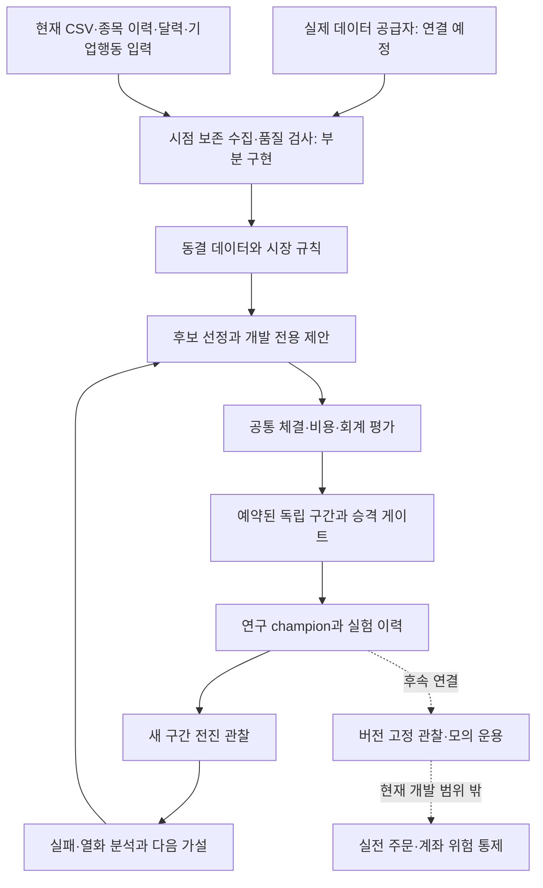

# 국내 주식 자기 개선 에이전트 — 기준 블루프린트 v1.0

작성일: 2026-10-16 KST. 코드 기준: `74e07e9`, 작업 범위 기준: `577fede`. 이 문서 묶음은 현재 제품의 설계·개발·운영 기준이다. 설계에 적힌 목표 기능과 실제 구현은 [진행 현황](status.md)에서 구분한다. 이번 변경은 문서 정리이며 런타임 기능을 추가한 결과가 아니다.

## 1. 만들려는 것과 현재 위치

국내 주식·ETF에서 매매할 수 있는 후보를 시점에 맞게 선정하고, 제한된 개선 가설을 같은 경제 조건으로 비교하며, 독립적인 새 데이터에서 통과한 전략만 연구 champion으로 교체하는 시스템을 만든다. 결과가 부족하면 유지·대기·실패를 기록한다. 장기적으로는 이 연구 결과를 검증된 계좌 운용으로 연결한다.

현재 네 단계의 **자동 연구 실행기**는 구현되어 합성 데이터에서 검증됐다. 실제 데이터 수집·실서버 계약 확인·상시 서비스·계좌 운용이 완성된 상태는 아니다. 현재 자기 개선은 사전 등록한 전략 파라미터의 탐색·평가·선택이다. ML 모델 재학습이나 코드 자동 수정은 미구현이다.

사용자가 정한 범위:

| 항목 | 적용 결정 |
| --- | --- |
| 시장 | KRX/KRW, 국내 주식·ETF. 기본 유니버스 KOSPI/KOSDAQ |
| 자본 | 연구 상한 1,000,000원. 실계좌의 기존 보유·미체결을 포함한 주문 상한 집행은 후속 개발 |
| 우선순위 | 후보 선정 → 전략 로직 → 자동 개선 → 실제 데이터의 전진 검증 → 주문 연결 |
| 미국 H1~H4 | 사용자 재개 지시 전까지 개발·연구 실행 보류. 코드·설정·골든은 보존 |
| 공통 회계 | 기존 원장을 재사용·유지. 미국 가설 연구 재개와는 별개 |
| 전략 갱신 권한 | 연구 champion만 자동 갱신. 브로커 주문·활성 실전 전략을 자동 변경하지 않음 |

## 2. 문서 지도

| 문서 | 확인할 내용 |
| --- | --- |
| **[진행 현황](status.md)** | 완료·부분 구현·미착수·보류, 코드/테스트 근거, 남은 연결 |
| [상세 구조와 계약](architecture.md) | 모듈, 책임, 입력·출력, 데이터, 원장, DB, 제어 경계 |
| [자기학습·개선 로직](self-improvement.md) | 현재 알고리즘·수식·일정·승격 조건, 향후 학습과 기억 설계 |
| [세부 개발 계획](implementation-plan.md) | 우선순위·작업 ID·선행 조건·구현 방법·완료 조건 |
| [운영 설계·절차](operations.md) | 실행·일일 운영·장애·복구·버전 전환·배포·단계 전환 |
| [기존 실행 안내](../automatic-research-agent.md) | 현재 CLI의 사용 예와 입력 형식 |

해석 순서: 사용자 범위 → 현재 코드와 검증 증거 → 본 기준 설계 → 과거 설계 문서. 과거 미국 명세나 KIS v0.2~v0.5 문서의 기능을 현재 통합 런타임이 모두 지원한다고 해석하지 않는다. 새 의사결정은 관련 작업 ID·정책 버전·현황을 함께 갱신한다.

## 3. 전체 구조

현재 실제 실행 경로는 `momentum.agent` → KIS `SelectionEngine`/계획 함수 → 공통 `Ledger` → 연구 저장소다. 위 그림의 제안·평가·기록·전진 관찰은 작동하지만, 실패 분석에 따른 탐색 공간 자동 재설계와 하위 운용 연결은 아직 계획이다.

## 4. 논리적 담당 모듈

여기서 담당 에이전트는 제품 내부의 책임 이름이다. 별도 개발 서브에이전트가 배정되어 병렬 실행 중이라는 의미는 아니다. 초기에는 한 프로세스와 SQLite에서 실행하고, 실제 격리가 필요한 부분만 나중에 프로세스를 나눈다.

| 역할 | 책임 | 결과물 | 현재 위치 |
| --- | --- | --- | --- |
| 데이터 담당 | 공급자 매핑, 시점·종목 이력, 달력, 기업행동 | 동결 입력·품질 보고 | 파일 계약 구현, 실제 수집 미연결 |
| 선정 담당 | 거래 가능성·예산·유동성·스프레드 필터 | 선정/제외 사유와 특징 | `selection.py` 구현 |
| 가설 담당 | 개발 데이터로 제한된 후보 생성 | StrategySpec·제안 이유 | 그리드 제안 구현, 학습형 제안 예정 |
| 평가 담당 | 모든 후보에 같은 체결·비용·회계 | EvaluationResult·거래/자산 곡선 | `CommonEvaluator` 구현 |
| 검증 담당 | 동결 계약·미사용 구간·통계·승격 판정 | 검증 증거·gate 결과 | 기본 게이트 구현, 확장 검증 예정 |
| 기억 담당 | 버전·실패·소비 구간·정책 이력 | 연구 DB·향후 실패 분류 | 영속 저장 구현, 분석 메모리 부분 |
| 연구 제어 담당 | 일정·단일 writer·champion 갱신·복구 | cycle·revision·상태 | `ResearchAgent` 구현 |
| 운영 담당 | 감시·건강 상태·백업·장애 대응 | 운영 상태·복구 기록 | 파일 감시 구현, 서비스화 예정 |
| 실행 담당 | 계좌 대사·주문 중복 방지·위험 상한 | OMS·체결 원장 | 기존 모의 코드 별도 존재, 통합/실전 후속 |

## 5. 성공의 기준

현재 단계의 성공은 자동 반복의 정확성이다. 같은 입력은 같은 증거를 재사용하고, 미래 정보·결측·평가 재사용·위험 정책 변경을 검출해야 한다. 유지한 전략과 실패한 후보도 기록으로 남겨야 한다.

실제 연구 단계에서는 데이터 출처·커버리지, 검증된 비용, 단순 기준 전략 대비 순성과, 낙폭·회전율·유동성, 새로운 전진 데이터의 지속성을 함께 본다. 수익률만 높거나 테스트가 많다는 이유로 시장 검증 완료로 표시하지 않는다. 실계좌 운용 준비는 별도 단계다.

## 6. 가장 먼저 해결할 작업

1. `DATA-01~06`: 실제 공급자 필드 적합성 확인, 역사적 종목 이력, 달력, 일관된 데이터 묶음과 수집 경로.
2. `FIN-01~04`: 실제 상품별 비용·호가, 기업행동의 신호 처리, 결제·기말 평가, 체결 현실성.
3. `RES-01~03`: 비교군과 독립 검증 정책 보강, 구간 격리·통계 민감도, 연구군 전체 탐색 예산.
4. `OPS-01~06`: 상시 운용·복구 증거·버전 전환·새 데이터 전진 캠페인.
5. `RES-04~06`: 실패 기억을 이용하는 제안과 제한된 모델 학습. 실제 데이터와 평가 기반이 마련된 뒤 확대.

개발 작업과 데이터가 도착하기까지의 대기 시간을 구분한다. 40개 새 거래일이 필요한 독립 검증을 코드 작업 속도로 줄일 수는 없다. 달력상 완료일은 공급자 적합성·가용 데이터·전진 구간 확보 후 정한다.
