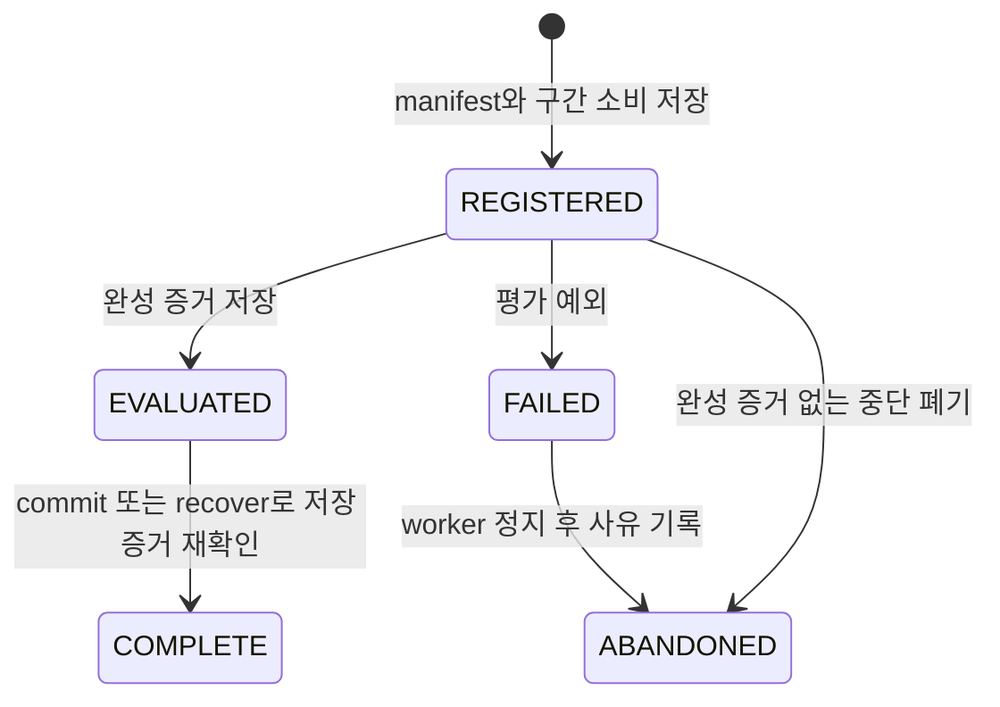

# 운영 설계·실행 절차·장애 대응

기준: [블루프린트](README.md). 이 문서는 **지금 가능한 로컬 연구 절차**와 **앞으로 구현할 상시 운영 체계**를 구분한다. 실제 데이터·실전 주문·백업 서비스가 현재 배포됐다는 뜻은 아니다.

## 1. 운영 모드와 권한

| 모드 | 현재 | 입력 / 출력 | 자동 변경 범위 |
| --- | --- | --- | --- |
| 합성 검증 | 가능 | 명시적 fixture → 검증 JSON·DB | fixture 연구 champion |
| 파일 기반 연구 | 가능 | 시점 보존 파일 → 후보·gate·연구 전략 | 등록된 연구의 champion |
| 파일 감시 연구 | 가능 | 같은 버전의 새 파일 → 새 예약 구간 평가 | 같은 정책·예산 안의 연구 진행 |
| 실제 수집 기반 연구 | 수집기 미연결 | 공급자 → 정규화 bundle → 연구 | DATA 단계 후 연결 |
| 실제 새 데이터 전진 관찰 | 파일 replay 기반 코드만 존재 | 새 데이터·고정 전략 → 성과·열화 | 상시 실데이터 캠페인은 미실시 |
| 모의 계좌 운용 | 별도 코드·fixture | selector-bound 연구 → 모의 OMS | 통합 연결·실서버 검증 후 |
| 실전 주문 | 미구현·후순위 | 별도 계좌 운용 계약 | 현재 활성화하지 않음 |

한투 실전 키는 현재 읽기 전용 어댑터에서만 사용할 수 있다. 자격증명 설정만으로 연구 수집·모의 운용·실전 주문이 자동 완성되지는 않는다. root 연구 CLI는 키 없이 실행된다.

## 2. 현재 실행 절차

저장소 루트에서 의존성을 고정한다. 개발 도구 없이 배포할 때는 `--no-dev --extra agent` 조합을 사용한다.

```bash
uv sync --extra agent --frozen
uv run --extra agent momentum-agent demo --output artifacts/agent-demo-v1
```

실제 연구에서는 원본·달력·비용·기업행동 커버리지를 확인한 입력을 따로 준비한다. 과거 소비 DB가 있으면 초기 연구 실행 전에 가져온다.

```bash
uv run --extra agent momentum-agent import-history \
  --db artifacts/krx-research/research.sqlite3 \
  --source-db /path/to/previous-research.sqlite3

uv run --extra agent momentum-agent init \
  --db artifacts/krx-research/research.sqlite3 --study krx-main

uv run --extra agent momentum-agent run \
  --db artifacts/krx-research/research.sqlite3 --study krx-main \
  --csv data/krx/prices.csv --securities data/krx/securities.jsonl \
  --sessions data/krx/sessions.json --actions data/krx/actions.json \
  --output artifacts/krx-research --watch --interval 30
```

`data/krx/*`와 과거 DB 경로는 운영자가 준비할 입력 위치의 예다. 현재 저장소에 실제 시장 자료가 포함됐다는 뜻은 아니다. `init`에서 `--policy`를 생략하면 예제 비용을 포함한 기본 연구 정책을 사용하므로 실제 자료 평가 전에 검증된 정책을 별도 고정한다.

CLI 기본 감시 간격은 30초, 허용 범위는 1~60초다. 이는 파일 확인 주기이며 매일 전략을 반드시 교체하거나 30초마다 거래하는 주기가 아니다. 데이터가 부족하면 `waiting_for_data`와 필요한 세션 수를 반환한다. `--max-ticks`로 유한 실행, `--max-cycles`로 전체 일정의 앞 N개를 제한한다.

## 3. 영속 상태와 프로세스 상태



실제 프로세스가 죽으면 REGISTERED가 남을 수 있다. EVALUATED에서 죽으면 recover로 완료할 수 있다. COMPLETE는 저장 결과를 재사용한다. ABANDONED도 소비를 취소하지 않는다. FAILED를 보지 못한 척 새 cycle로 덮어쓰지 않는다.

`WAITING_FOR_DATA`, watcher 실행 중, 최종 예산 소진은 조회·프로세스 상태이며 위 cycle 상태와 동일한 DB enum이 아니다. 최대 검증 횟수와 마지막 shadow 구간이 끝나면 watcher는 종료한다.

## 4. 실제 데이터 운영 일과 — 구현 목표

아래 수집·서비스 절차는 `DATA-06`, `OPS-01~06`의 목표다. 고정 16시 실행을 모든 거래일에 적용하기보다 실제 달력과 공급자 확정봉 시각을 따른다.

| 시점 | 수행 내용 | 통과 조건 / 실패 처리 |
| --- | --- | --- |
| 장 전 | 달력·거래 상태·소스·서비스 건강·미완료 cycle 점검 | 휴장·특별장 구별. 미완료 최종 평가 자동 재시작 금지 |
| 장 중 | 필요할 때 읽기 전용 데이터 수집, 공급 지연·변경 추적 | 실제 API 예산·계좌 권한에 맞춤. 연구 평가와 분리 |
| 확정봉 공개 후 | 원본 수집·정규화·행동/종목/달력 결합·품질 검사 | 실패 bundle은 공개하지 않고 원인 기록 |
| 입력 공개 후 | 일정·소비·정책·빌드 확인 | 데이터 부족은 대기. 데이터 오류는 연구 실패와 구별 |
| 평가 가능한 날 | 개발·최종 평가·연구 갱신 또는 유지 | 현재 gate와 사전 등록 계약 전체 충족 |
| 관찰 가능한 날 | 현재 연구 버전과 이전 버전의 전진 성과·열화 기록 | selector·비용·데이터 버전 유지 |
| 일과 종료 | 보고·백업·consumption witness·다음 필요 세션 점검 | 최신 입력·마지막 정상 실행·미처리 장애가 구분됨 |

## 5. 운영 지표와 보고

| 지표군 | 현재 얻을 수 있는 값 | 추가할 값 |
| --- | --- | --- |
| 데이터 | checkpoint 날짜·해시, 선정/제외 사유 | 공급 지연·커버리지·정정·bundle 일치·수집 실패 코드 |
| 연구 | cycle 상태, revision, gate, trials, 필요한 새 세션, 예산 소진 | 연구군 전체 탐색 횟수·소요 비용·가설 중복 |
| 경제 | NAV·현금·배당채권·거래·수수료·회전율·낙폭 | 실제 비용 대비 오차·결제·청산 NAV·단순 비교군 |
| 전진 | 신규/기존 전략 순성과, 낙폭, 열화 flag | 특징/모델 drift, 장기 일관성·계좌 대사 |
| 서비스 | CLI 반환·JSON·DB 이벤트 | heartbeat·PID·마지막 정상 bundle·재시작 이유·알림 delivery |

정상 보고는 '승격 성공'만 세지 않는다. 유지 이유, 증거 부족, 미노출 데이터 잔량, 실패 분류, 최신 상태의 시각을 포함한다. 계좌·토큰·키 원문을 일반 로그나 보고서에 넣지 않는다. 현재 자동 알림 전송 기능은 없으며 채널·권한·실제 전달 검증은 OPS-03에서 구현한다.

## 6. 장애 처리 표

| 상황 | 현재 가능한 조치 | 재시작 조건 |
| --- | --- | --- |
| 새 데이터 부족 | 기다림. 필요 세션 수 확인 | 고정 일정의 새 자료가 도착 |
| 잘못된 CSV·종목·달력·행동 | 원본 보존, 입력 작성 원인 확인 | 사용한 prefix를 바꾸지 않는 올바른 새 버전 |
| 과거 prefix 변경 | worker 중지·버전 영향 분석 | 원래 자료 복구 또는 별도 정책/데이터 전환 |
| 최종 평가 중 예외·process fault | 상태·manifest·소비를 확인 | 완성 증거가 없으면 정지 후 사유 있는 abandon, 구간은 보존 |
| EVALUATED에서 중단 | recover | 저장 증거의 해시·gate·정책·revision 일치 |
| 빌드가 달라 기존 연구 거부 | 기존 코드·DB 보존 | 검토된 마이그레이션. 임의로 build 필드를 덮어쓰지 않음 |
| shadow 열화 | 보고와 원인 조사 | 현재 root flag는 자동 중단/rollback이 아님. OPS-05의 운용 통제 추가 필요 |
| DB 손실·과거 backup만 있음 | 임의 재실행 금지, 최근 소비 증거 확보 | 손실 구간을 격리한 일관 복원 완료 |
| 모의 OMS UNKNOWN | 별도 읽기 대사로 broker identity·체결 확인 | 확인 전 재전송 금지. root 연구 복구와 혼동하지 않음 |

현재 복구 명령:

```bash
uv run --extra agent momentum-agent status \
  --db artifacts/krx-research/research.sqlite3 --study krx-main

uv run --extra agent momentum-agent recover \
  --db artifacts/krx-research/research.sqlite3 --cycle-id CYCLE_ID

uv run --extra agent momentum-agent abandon \
  --db artifacts/krx-research/research.sqlite3 --cycle-id CYCLE_ID \
  --reason "Worker stopped; incomplete evaluation retained"
```

abandon은 worker를 종료하는 명령이 아니다. 실제 프로세스가 멈춘 뒤 사용한다. 완성 증거가 있는 실행을 폐기해 유리한 결과를 다시 뽑을 수 없다.

## 7. 백업·복원·보존 — 추가 구현

현재 백업 scheduler나 복원 리허설 증거는 없다. OPS-02의 보존 단위는 DB만이 아니라 다음 묶음이다.

- 연구 DB의 일관된 snapshot과 schema 버전. 실행 중 파일 단순 복사 대신 SQLite online backup API 또는 정지된 일관 snapshot 사용.
- 원본과 동결 입력 bundle, 공급자 출처·라이선스/접근 범위, 정정 이력.
- 소스 빌드·환경 lock·정책·전략·모델/프롬프트 ID와 실행 산출물.
- DB와 별도로 확인 가능한 소비 checkpoint/witness. 과거 backup으로 복원했을 때 사라진 최근 평가 구간을 탐지할 수 있어야 함.

복원은 새 worker 시작 전 schema·해시·pending cycle·최근 소비·최신 bundle을 대사한다. 소비 여부를 확정할 수 없는 날짜는 격리한다. 복원 시험의 목표는 DB가 열리는 것뿐 아니라 이미 본 검증 표본을 다시 사용하지 않는 것이다. RPO/RTO는 이 리허설 결과로 수치화하며 현재 달성했다고 표시하지 않는다.

실제 연구 DB·원본·키·토큰은 Git에 넣지 않는다. 합성 산출물도 실제 연구 이력과 구별한다. 소비 이력을 삭제해서 새 빌드를 실행 가능하게 만들지 않는다.

## 8. 버전 전환

| 변경 | 현재 계약 / 전환 설계 |
| --- | --- |
| 코드 | source hash가 달라지면 연구 거부. 기존 빌드를 보존하고 영향 회귀를 확인 |
| 데이터 정정 | 기존 prefix를 덮어쓰지 않고 별도 버전으로 보관, 노출·소비 승계 |
| 비용·위험·평가 기준 | 초기 정책 불변. 새 정책의 탐색/평가 예산과 새 표본 요구량을 등록 |
| 모델·특징·제안 공간 | 새 후보/연구군 버전. 이전 시도를 기억·예산에서 제외하지 않음 |
| DB | schema·champion·소비·연구군 상태와 rollback 범위를 함께 이전 |

현재 `import-history`는 소비 구간만 가져온다. champion·pending cycle·환경·학습 기억을 자동 이전하는 기능은 아니다. OPS-04에서 전체 이전 manifest와 역호환 회귀를 만든다. 새 DB를 만들었다는 이유로 독립 평가 이력이 사라지면 안 된다.

## 9. 연구에서 계좌 운용으로 넘어가는 조건

현재 연구 통과는 운용 자격이 아니다. 다음 조건을 각 단계의 증거로 확인한다.

| 단계 | 추가로 필요한 증거 |
| --- | --- |
| 실제 연구 | PIT 입력 커버리지, 실제 비용·행동·달력, 비교군·새 구간의 연구 결과 |
| 상시 전진 관찰 | 서비스·데이터 장애·backup 복원·selector-bound 관찰 버전, 새 데이터 캠페인 |
| 모의 운용 | 실제 모의 서버의 잔고·미체결·부분 체결·수수료·응답 유실·취소 계약 |
| 후속 실전 운용 | 기존 보유·미체결·예약 수수료를 포함한 총자본, 실제 주문 가능 현금, 위험 중단·대사·재개 계약 |

100만 원은 전체 운용 자본의 상한이어야 하며 매 연구·매 주문마다 별도로 다시 사용할 수 있는 금액이 아니다. 실전 키로 읽기가 가능하다는 사실과 주문 엔진의 준비 상태는 구분한다. 미국 H1~H4는 이 운영 전환 작업에서도 계속 보류한다.

## 10. 클라우드 ↔ 맥 결과 전달 (2026-10-26 사용자 확정)

- **클라우드 → 맥:** 클라우드 주관 세션이 실행 블록을 맥 세션에 `send_message`로 보낸다(`.claude/settings.json` 허용 규칙).
- **맥 → 클라우드 (2026-10-27부터 기본, 사용자 결정):** 맥은 결과 **요약 txt만** 구글 드라이브 동기화 폴더의 `내 드라이브/momentum-results/`(드라이브 폴더 ID `1E7WClU3plm_INXB9jSiyVGhCVDsKLrep`)에 쓴다. 클라우드는 Google Drive 커넥터로 파일을 찾아(`search_files`) 내려받는다(`download_file_content`). 원자료(`data/kis`·`data/krx`, KIS 응답 원문, 키)는 드라이브에 쓰지 않는다. 파일 이름은 `<작업>-<날짜>.txt`로 하고, 같은 이름을 덮어쓰지 않는다. 드라이브가 동작하지 않을 때만 아래 git 브랜치 방식을 쓴다.
- **맥 → 클라우드 (예비: git 브랜치):** 맥 세션의 `send_message`는 신뢰 기기 인증이 필요한 주관 세션으로 가지 못한다(`elevated_session_untrusted_device`). 대신 결과를 git 브랜치로 넘긴다.
  1. 맥은 메인 작업 트리를 건드리지 않고 임시 worktree에서 코드 없는 orphan 브랜치 `results/<이름>`을 만든다. 결과 txt만 커밋해 푸시한다. `data/krx/`·`artifacts/`·키·로그는 넣지 않는다. 임시 worktree와 로컬 브랜치는 바로 지운다.
  2. 클라우드가 그 브랜치를 읽어 판정·기록한다.
  3. 원격 브랜치 삭제는 클라우드에서 막혀 있다. 클라우드가 다 읽은 `results/*` 브랜치는 이름을 적어 맥에 삭제를 요청하고, 맥은 묻지 않고 바로 지운다(사용자 지시 2026-10-26). 이 규칙은 `results/*`에만 적용한다. `main`·PR 브랜치 등 다른 브랜치 삭제는 사용자에게 먼저 묻는다.
- 블록의 0단계에서 맥 HEAD(`git log --oneline -1`)를 출력해 원격 main과 같은지 확인한다.
