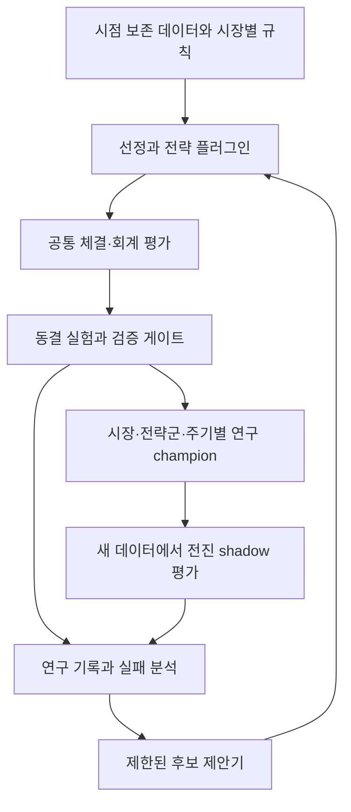

# 미국 검증 엔진과 KIS 연구 루프의 통합 설계

2026-10-16. 코드 기준: `8f410a5`의 미국 `src/momentum`과 KIS `apps/kis-agent` 0.5.1. 이 문서는 구현 현황 비교와 다음 개발 설계다. 공통 런타임이나 미국 최종 평가 기능을 구현한 결과는 아니다.

후속 구현: [자동 연구 에이전트 v1](automatic-research-agent.md)에 미국 원장과 KIS 선정을 연결한 네 단계 실행기·공통 소비 이력·감시 CLI를 추가했다. 아래 표는 위 기준 커밋의 비교이며, 미국 H1~H4 최종 평가와 실제 데이터 연결 등 남은 항목은 후속 문서의 범위를 따른다.

## 결론과 현재 차이

미국 엔진의 체결·회계 기반 위에 KIS의 후보 선정·실험 관리·제한된 자동 개선 루프를 연결한다. 전략과 시장 정책은 플러그인으로 유지한다. 두 엔진은 보완 관계지만, 현재 어느 쪽도 실제 데이터에서 투자 우위가 입증된 완성형 에이전트는 아니다.

| 항목 | 미국 검증 엔진: 구현 | KIS 연구 앱: 구현 | 통합 판단 |
| --- | --- | --- | --- |
| 목적 | 고정된 H1~H4 모멘텀 가설 비교 | 후보 선정과 반복 연구, 연구 champion 갱신 | 검증 기반과 연구 제어기를 결합 |
| 전략 | 일·주·월 및 12-1 모멘텀, H3는 역사적 발행주식 수 필요 | momentum / risk_adjusted / trend_stability와 제한된 lookback 탐색 | 원래 H1~H4 보존, 변형은 별도 ID로 등록 |
| 정보 시점 | `AsOfFrame`, 대체로 날짜 단위 available_at | 시간대 있는 시각의 Snapshot / SecurityHistory | 정밀도와 공개 시점 보존, 날짜를 임의 공개 시각으로 바꾸지 않음 |
| 체결·회계 | 전일 계획·다음 시가 체결, Decimal, 분할·배당채권·NAV 대사·손계산 골든 | 전일 계획·다음 시가 체결, 거래량·위험 제약, 단순 Wallet | 미국 원장을 공통 기반 후보로 삼되 통화·체결 수수료 계약부터 보완 |
| 검증 실행 | 합성 데이터 development CLI. walk-forward 미구현, holdout 잠김 | 개발 fold → 후보 선택 → 동결 manifest → 최종 구간 평가 | 미국 명세를 KIS 평가 결과로 대신 충족시킬 수 없음 |
| 통계 | 블록 bootstrap·네 가설 Holm 보정은 명세에 존재, 판정 실행기는 미구현 | 지표·블록 bootstrap·비용 스트레스의 제한된 승격 게이트 | 보유 기간·벤치마크·다중 탐색에 맞춘 검증 기능 추가 필요 |
| 연구 운영 | 실행별 설정·데이터 해시와 Git commit 기록 | SQLite 연구 이력, holdout 소비, 재시작·복구, champion 버전 충돌 방지 | 공통 provenance와 소비 기록을 통해 실험 중복 방지 |
| 외부 연결 | 실제 데이터 공급자 미연결 | KIS 실전 읽기 어댑터, 별도 모의 OMS; 실제 연결 검증 미완료 | 연구 개선부터 완료, 연구 승격과 실전 주문은 분리 |

미국 쪽의 장점은 경제 계산을 추적하고 잘못된 백테스트를 잡는 기반이다. 단점은 실제 데이터 공급과 검증 실행·반복 연구가 덜 연결된 점이다. KIS 쪽의 장점은 후보부터 연구·실패·복구까지 이어지는 운영 흐름이다. 단점은 단순 회계, 좁은 탐색 공간, 제한된 통계 검증이다. 테스트 통과는 이러한 코드 계약에 대한 증거이며 시장 수익성 증거가 아니다.

소스 근거: [미국 CLI](../src/momentum/cli.py), [신호 계약](../src/momentum/signals/base.py), [원장](../src/momentum/ledger/ledger.py), [판정 경계](../src/momentum/evaluate/decide.py), [KIS 연구 루프](../apps/kis-agent/src/trading_agent/logic.py), [평가](../apps/kis-agent/src/trading_agent/evaluation.py), [연구](../apps/kis-agent/src/trading_agent/research.py), [저장소](../apps/kis-agent/src/trading_agent/store.py).

## 목표 구조

KIS는 증권사 연결 방식이고 미국·한국은 시장 구분이다. 장기적으로 한투 해외주식 어댑터도 연결할 수 있으나 현재 국내 읽기 구현이 미국 주문을 지원한다는 뜻은 아니다. 시장과 증권사를 별도 축으로 설계한다.

두 기존 CLI·패키지를 유지하면서 어댑터를 추가한다. 공통 계약부터 합의하고 회계와 평가 기능을 순차적으로 연결한다. 공통화 대상과 시장별로 남길 대상은 다음과 같다.

| 공통 계약 / 모듈 | 책임 | 유지할 차이 |
| --- | --- | --- |
| `DatasetSnapshot` | 영구 종목 ID, 데이터 버전, effective/available 시점, 출처와 정밀도 | 시장·거래소·상장폐지 이력, 실제 거래일과 시간대 |
| `StrategySpec` / `RankResult` | 순위·선정 사유·unavailable 상태, 관측 기간·리밸런싱 주기 | H1~H4 정의, KIS 후보 필터, 데이터 요구량 |
| `TargetPlan` / 체결 이벤트 | 실행 전 수량 동결, 체결·취소·결측 사유 기록 | 호가 단위·정수/소수 주식·거래량 제한·체결 가능 시간 |
| 회계·비용 엔진 | 현금·보유·수수료·배당·분할과 NAV 대사 | 통화 정밀도·상품별 세금·결제·기업행동·환전 |
| `EvaluatorPort` | 평가 입력·결과·지원 기능의 명시적 계약 | 개발/전진/최종 평가 지원 여부, 시장별 평가 정책 |
| `FrozenExperimentManifest` / 연구 저장소 | 코드·데이터·정책·탐색 예산 동결, 평가 소비와 실행 이력 보존 | 시장·전략군·주기별 실험과 champion |
| 연구 제어기 | 후보 제안, 개발 평가, 검증, 유지/승격, 실패 기록·복구 | 사전 등록된 전략별 탐색 공간 |

필수 세부 규칙:

- 미국의 센트 단위 원장을 원화에 그대로 적용하지 않는다. 통화별 반올림·수수료 누적·부분 체결 중복 방지를 명시하고, 기존 달러 골든 결과를 보존한다.
- 현재 미국 calendar는 입력 세션 목록을 사용하며 실제 거래소 휴일·시간대 공급자가 아니다. KIS의 고정 장 시간도 실제 KRX 달력으로 보완해야 한다. 배당·분할·상장폐지·환율 데이터가 없으면 지원 불가를 표시한다.
- 미국 H3의 발행주식 수 회전율을 KIS의 거래대금 proxy로 대체하지 않는다. H4의 12-1 데이터 요구량을 KIS의 기본 단기 warmup에 맞춰 줄이지 않는다.
- 미국의 오래된 보유 종목 표시와 KIS의 보유 가격 누락 시 실패는 서로 다른 정책이다. 공통 결과에 데이터 품질 상태를 포함하고, 명시한 정책에 따라 처리한다.
- 수익률·점수는 시장·보유 기간·벤치마크·비용 조건 없이 합치지 않는다. 기본 미국 연구 계좌 USD 30,000은 사용자의 KRW 1,000,000 투자 예산과 별개다. 향후 두 시장에 투자하면 원화 환산 총자본·환전 비용·예약 현금을 함께 관리한다.
- 미국 평가 어댑터는 현재 development만 지원한다고 선언해야 한다. KIS 루프에서 development 함수를 호출하는 방식으로 잠긴 미국 holdout을 우회하지 않는다.

## 자기 개선의 범위와 과최적화 방지

현재 자동 개선은 사전 등록된 lookback·ranking 안에서 후보를 찾고 조건을 통과한 연구 전략을 갱신하는 수준이다. 코드·비용·위험 한도·합격 기준을 스스로 바꾸는 기능은 없다. 초기 통합도 이 경계를 유지한다.

1. 개발 데이터와 개발 실패 기록으로 개선 가설을 만든다. LLM을 사용하더라도 근거와 제한된 파라미터 제안만 받는다.
2. 후보 ID, 전체 탐색 이력·예산, 코드/데이터 해시, 비용·벤치마크·검증 기준을 최종 평가 전에 고정한다.
3. 개발 구간의 시간 순서 fold에서 후보를 비교한다. 겹치는 수익 구간은 실제 보유 기간에 맞춰 purge/embargo 등 격리 규칙을 정한다.
4. 독립적인 최종 구간은 등록된 계약으로 한 번 평가한다. 비용 차감 우위·낙폭·거래 가능성·비용 스트레스·통계 조건을 함께 판정한다. 미국 H1~H4의 네 가설 보정 정책과 추가 후보 탐색의 다중 검정 정책을 별도로 명시한다.
5. 통과하면 해당 시장·전략군·주기의 연구 champion을 갱신하고 새로 도착하는 데이터에서 shadow 추적한다. 실패하면 기존 전략을 유지한다.
6. 최종 구간 결과를 보고 후보를 수정했다면 그 구간은 더 이상 미공개 평가 표본이 아니다. 다음 후보는 새로운 독립 구간을 기다린다. 단순히 다음 거래일을 추가하거나 실험 이름을 바꾸는 것으로 독립성이 생기지 않는다.

공통 평가 소비 저장소는 두 패키지와 과거 DB의 소비 구간을 먼저 가져온다. 연구 이름·브로커·종목 별칭·코드 버전 변경으로 소비 이력이 사라져서는 안 된다. 시장 간 같은 날짜가 독립 표본인지도 상관관계와 데이터 노출을 고려해 평가 계약에서 정한다. 기존 미국 설정에 적힌 과거 holdout도 노출 이력 확인 없이 새 표본이라고 가정하지 않는다.

현재 KIS bootstrap의 고정 5일 블록과 작은 개선 임계값을 미국 월간 전략에 일괄 적용하지 않는다. 검증 정책과 탐색 예산을 변경할 때는 별도 연구 버전으로 등록한다. selector가 포함된 연구 결과에서 selector 계약을 버려 이전 momentum 전용 shadow 증거로 승격시키지 않는다.

이 구조의 개선 대상은 재현 가능한 비용 차감 성과와 위험·안정성이다. 반복 자체가 수익 증가를 보장하지 않으며, 근거가 부족하면 유지 또는 평가 보류가 정상 결과다.

## 개발 순서와 완료 조건

아래는 구현 모듈의 책임 구분이다. 별도 실행 에이전트가 현재 배정되거나 동작 중이라는 의미는 아니다.

| 순서 | 담당 모듈 | 구현 범위 | 완료 기준 |
| --- | --- | --- | --- |
| 1 | 공통 계약·연구 기록 | 평가 포트, 시장 프로필, 동결 manifest, 코드/데이터 provenance, 기존 소비 기록의 통합 조회 | 미래 정보·정밀도 손실·소비 재사용·지원하지 않는 평가 단계 요청을 거부. 양쪽 CLI 유지 |
| 2 | 체결·회계 | 미국 원장의 재사용 경계, 통화·기업행동·상품별 비용, KIS 누적 체결 이벤트 | 기존 미국 골든 보존. 공통 지원 fixture에서 양쪽 대사 일치. 시장 정책 차이는 명시적 기대 결과로 검증 |
| 3 | 전략·검증·연구 제어기 | KIS 루프와 평가 포트 연결, 미국 walk-forward/최종 판정 구현, 사전 등록 전략군·다중 검정 | 모든 후보에 동일 체결 기반 적용. 동결 전 최종 표본 접근 금지. 반복 실행·중단 복구로 평가 재소비 불가 |
| 4 | 실제 데이터·전진 관찰 | 시점 보존 공급자, 실제 달력, benchmark, shadow·열화 탐지 | 미연결·결측을 명시. 과거 수익 재현과 새 데이터의 연구 성과를 구분해 추적 |
| 후속 | 브로커 실행 | 연구와 별도 주문 연결·자본 통제 | 현재 우선 개발 범위 밖. 연구 champion 갱신만으로 실전 주문하지 않음 |

첫 개발 단위는 1번이다. 바로 전략 탐색 범위를 늘리기보다, 두 평가기가 같은 계약으로 무엇을 평가할 수 있는지와 어떤 평가 구간을 이미 소비했는지부터 연결한다. 기존 통과 테스트 수를 늘리는 것보다 미래 정보 차단·회계 대사·평가 재사용 방지의 회귀 증거를 우선한다.

## 이번 변경의 검증 범위

본 변경은 설계 문서와 README 연결만 추가한다. 소스 경로·상태 설명을 코드와 대조하고 문서 diff를 검사한다. 직전 코드 통합의 미국 190개 / KIS 122개 테스트 통과 기록은 [저장소 통합 문서](kis-agent-integration.md)에 있으며, 이번 설계가 런타임에서 구현되었다는 증거로 사용하지 않는다.
